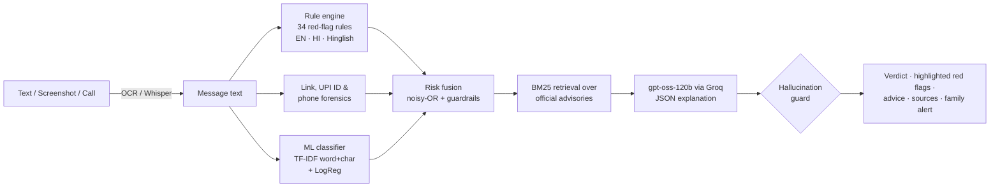

# 🛡️ ScamShield India

**Paste a WhatsApp/SMS, upload a screenshot, or drop in a call recording, and find out in seconds whether it's a scam, which trick is being used, and exactly what to do next.** It works in English, Hindi and Hinglish.

India loses thousands of crores a year to "digital arrest" calls, fake KYC links, UPI PIN tricks and task-job scams. Most victims aren't careless. They just get a message at the wrong moment, and nobody is around to say *"wait, that's a known scam."* ScamShield is that person.

> **Demo:** [Try it live](https://scamshield-india-hv3ufivesv52dtdy8yswey.streamlit.app/)  ·  **Built by** [Ketan Gupta](https://www.linkedin.com/in/ketangupta05)

---

## What it does

| Input | How |
|---|---|
| 💬 Text | Paste any message: English, Hindi (Devanagari) or Hinglish |
| 🖼️ Screenshot | Tesseract OCR (English + Hindi), with dark-mode support |
| 📞 Call / voice note | Whisper-large-v3 on Groq transcribes Hindi/English calls |

For every message you get:

- **A verdict:** `SCAM`, `SUSPICIOUS`, or `No known scam pattern`. It **never says "safe"**, on purpose (see below).
- **Which scam it is**, out of 11 types: digital arrest, fake TRAI, UPI PIN/QR/collect trick, stock-tip groups, task jobs, malicious APK / screen-sharing, KYC phishing, electricity bill, lottery, instant loans, and family impersonation.
- **The exact red-flag phrases highlighted** in the message, each with a plain-language reason.
- **Link forensics:** look-alike bank domains (`hdfcbnk.com`), shortened links, `.apk` downloads, punycode and cheap TLDs, all checked *without ever opening the link*.
- **What to do now,** in English or Hindi, plus official sources.
- **A one-tap WhatsApp warning** you can forward to the family group.

## Architecture



### Design decisions worth knowing

1. **Rules + ML, fused.** Rules give explainable evidence ("this exact phrase is the red flag"). The classifier, using character n-grams, catches phrasings the rules have never seen and copes with Hinglish spelling variation. The blind test below shows that neither works well alone.
2. **"Context" vs "evidence".** Mentioning *Delhi Police* or *TRAI* isn't suspicious; real awareness SMSes do it too. These "context" rules can never push a message to `SCAM` without real evidence (an OTP request, a PIN-to-receive claim, a risky link…).
3. **Negation-aware.** "*Never share your OTP*" is advice; "*share your OTP*" is an attack. Real bank OTP messages are not flagged.
4. **It never says "safe".** A false "safe" is the most harmful mistake a tool like this can make, so the lowest verdict is "no known scam pattern found — not a guarantee".
5. **The LLM is on a leash (the hallucination guard).** Every check is deterministic code, not a prompt:
   - every red flag the LLM lists must quote text that is **actually in the message**, or it is dropped;
   - every citation must be an advisory chunk that was **actually retrieved**;
   - the LLM can **never lower** the engine's verdict, and can only raise it one level with verified evidence;
   - any phone number or link the LLM writes that isn't in the message is removed. **Helplines and advice come from code, never from the model**, so a hallucinated "helpline number" can't reach a scared user;
   - if the LLM's summary contradicts the final verdict, it's replaced.
6. **Works with no API key.** Without `GROQ_API_KEY`, the full rule + ML + retrieval pipeline still runs and builds its explanation from its own evidence. Only call transcription needs the key.
7. **Current facts.** The rules encode things like NPCI discontinuing person-to-person UPI collect requests from **1 Oct 2025**. So a "collect request" from an individual is now itself a red flag.

## Results

The tool was evaluated on a **blind test set of 60 messages written after all tuning was finished and run once** (`eval/test.csv`). Flagged = SCAM or SUSPICIOUS.

| System | Scams caught (recall) | Precision | F1 | Genuine messages wrongly flagged |
|---|---|---|---|---|
| Rules only | 53.3% | 94.1% | 0.681 | 3.3% |
| ML model only | 100.0% | 88.2% | 0.938 | 13.3% |
| **ScamShield (fused)** | **93.3%** | **96.6%** | **0.949** | **3.3%** |

The genuine messages include deliberately tricky ones: real OTP SMSes, bank credit alerts, recruiter messages, police awareness tips and electricity bills. Full report: [`eval/report_test.md`](eval/report_test.md). The tuning set results are in [`eval/report_dev.md`](eval/report_dev.md).

**Honest limitations.** Every message here was written by me, modelled on patterns in official advisories. None of it is real victim data, so real-world performance will be lower, and with 60 test messages the error bars are wide. The next step is a test set of real, consented, redacted messages. The blind test also missed two scams with no explicit money ask, which shows where the rules need to grow.

## Run it

```bash
pip install -r requirements.txt          # + Tesseract: apt install tesseract-ocr tesseract-ocr-hin
python -m scamshield.classifier          # train the classifier (takes a few seconds)
streamlit run app.py
```

Optional: `export GROQ_API_KEY=...` (free at console.groq.com) for LLM explanations and call transcription.

```bash
pytest -q                                # 23 unit tests, including the hallucination guard
python -m eval.evaluate test             # reproduce the numbers above
```

**Deploy free on Streamlit Community Cloud:** push this repo → *New app* → main file `app.py` → add `GROQ_API_KEY` under *Secrets*. `packages.txt` installs Tesseract with Hindi.

## Project layout

```
scamshield/
  signals.py      34 red-flag rules (EN/HI/Hinglish), negation handling
  links.py        URL / UPI ID / phone forensics, look-alike domain detection
  classifier.py   TF-IDF (word + char n-grams) + logistic regression
  engine.py       risk fusion → verdict, scam type, advice
  kb.py           BM25 retrieval over knowledge_base/
  explain.py      Groq LLM explanation + hallucination guard
  taxonomy.py     scam types and fixed advice/helplines (EN + HI)
  ocr.py, audio.py, alert.py
knowledge_base/   official advisories rewritten in plain language, with source links
data/messages.csv training data · eval/ dev + blind test sets and reports
```

## Sources

The knowledge base paraphrases and links to: the I4C "digital arrest" advisory, TRAI's advisory on frauds misusing its name, NPCI's UPI Safety Shield and its Oct-2025 P2P collect-request change, RBI's *BE(A)WARE* booklet, DoT's Chakshu facility on Sanchar Saathi, I4C's warning on WhatsApp/Telegram stock-tip scams, Tata Power-DDL's billing-fraud advisory, and Quick Heal's 2026 mid-year fraud report. See the `sources:` list in each `knowledge_base/*.md` file.

## Disclaimer

ScamShield is an awareness tool, not a guarantee and not legal advice. **If you lost money, call 1930 immediately** and report at [cybercrime.gov.in](https://cybercrime.gov.in). To report a suspicious number or message, use **Chakshu** on the Sanchar Saathi portal.
